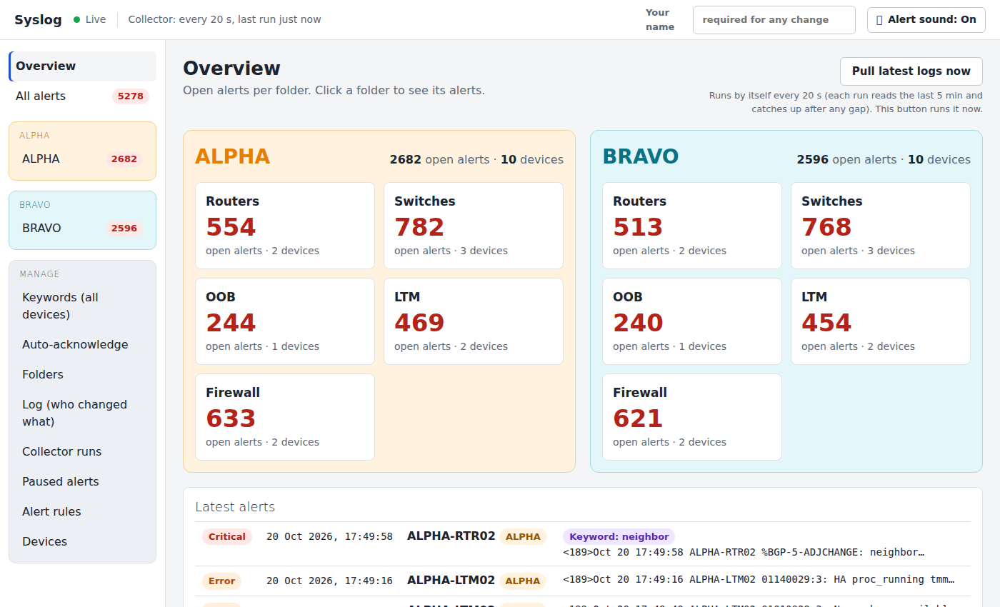
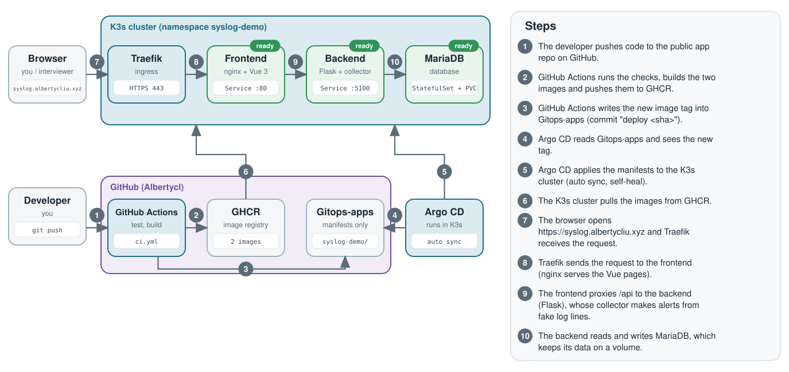

# Syslog-demo

**Live demo:** https://syslog.albertycliu.xyz (made-up data, no login)

A portal that turns raw network device logs into a short list of alerts that an on-call team can acknowledge, pause and track.



## What it does

- Turns log lines from routers, switches, load balancers and firewalls into alerts (the demo uses a built-in fake log generator) and shows open alerts per group and per device type.
- Lets people acknowledge, pause, mute or escalate an alert, and set rules per device (which severities alert, which keywords always alert or are ignored, auto-acknowledge time windows).
- Keeps a log of who changed what..

## How it works



Code goes to GitHub, GitHub Actions builds the images and updates the [Gitops-apps](https://github.com/Albertycl/Gitops-apps) repo, and Argo CD deploys the change to a K3s cluster by itself.

## SRE skills this shows

- **GitOps and CI/CD:** GitHub Actions, GHCR, Argo CD with auto sync and self-heal.
- **Rollback:** `git revert` of the "deploy" commit in Gitops-apps.
- **Containers:** one Dockerfile per component, Docker Compose, database health check.
- **Configuration:** all settings come from environment variables, and secrets are never stored in Git.
- **Kubernetes:** MariaDB StatefulSet with a volume, Traefik ingress with a Let's Encrypt certificate, startup, readiness and liveness health checks.
- **Operations:** a health endpoint, a collector status page and an audit log.

## Run it locally

Prerequisites: Docker with the compose plugin.

```bash
cp .env.example .env     # set MYSQL_ROOT_PASSWORD and DATABASE_URL (bundled database, see .env.example)
docker compose --profile db up --build
```

Then open `http://localhost:8090`. You can also point `DATABASE_URL` at your own MariaDB and run `docker compose up --build`.

## More

[Full details](docs/DETAILS.md): install on Kubernetes, CI/CD, monitoring and known limits.
